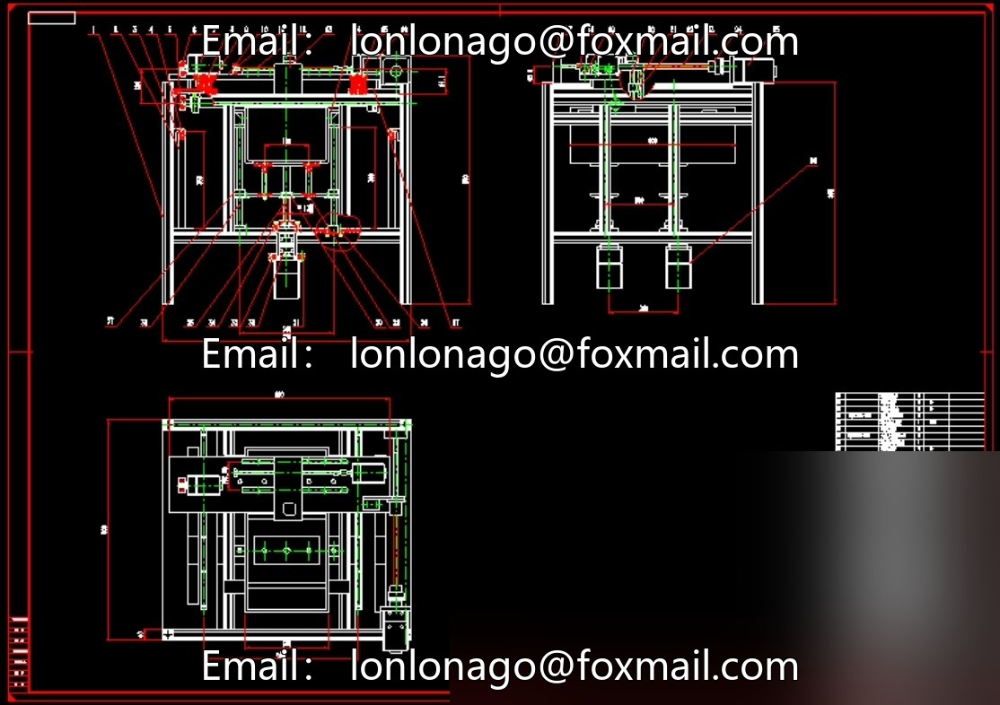
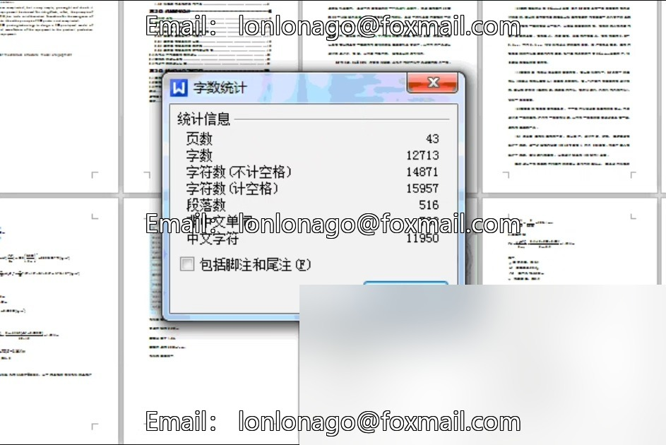

# 3D printer design 3D printer design diagram 3D printer CAD diagram 3D printer CAD drawing

## Body

3D printer design; 3D printer design drawings; 3D printer CAD drawings; 3D printer design drawings
3D printer structure design; 3D printer structure design drawings; 3D printer structure design CAD drawings; 3D printer structure design drawings
This material contains the manual plus 2D drawings
513

The material covers 3D printer design, design drawings, CAD charts, structural design and assembly drawings, including manuals and two-dimensional figures, along with size statistics and related documents.

<!-- AI_ENRICHED -->

## Images

## Payment

Here is a pay link on Stripe ( https://buy.stripe.com/3cs8yP7sY87d0vu9AB ). Please contact me lonlonago@foxmail.com after funding $89, and I will send you a complete data files , thank you!

